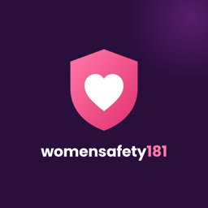
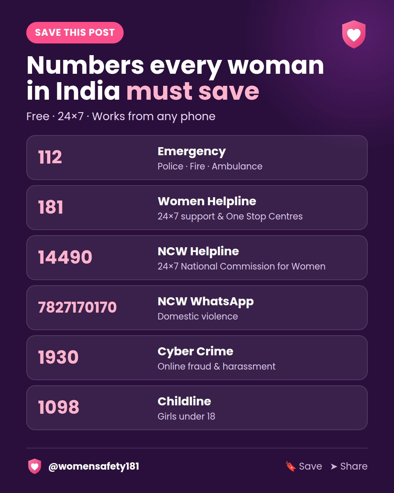
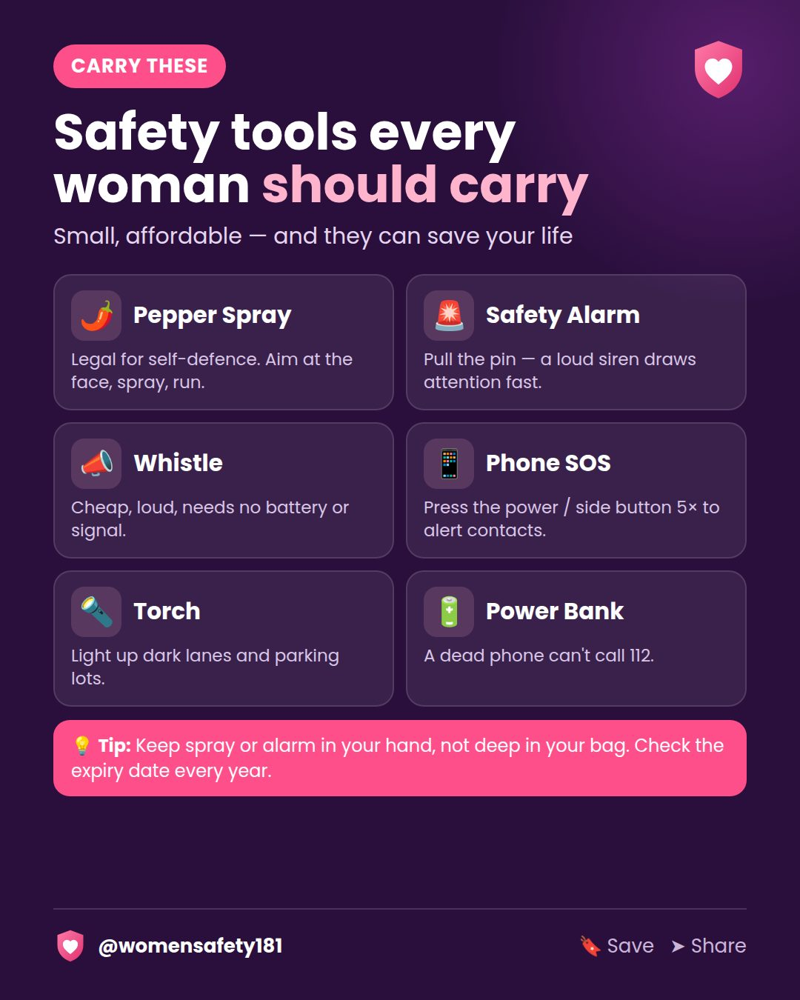
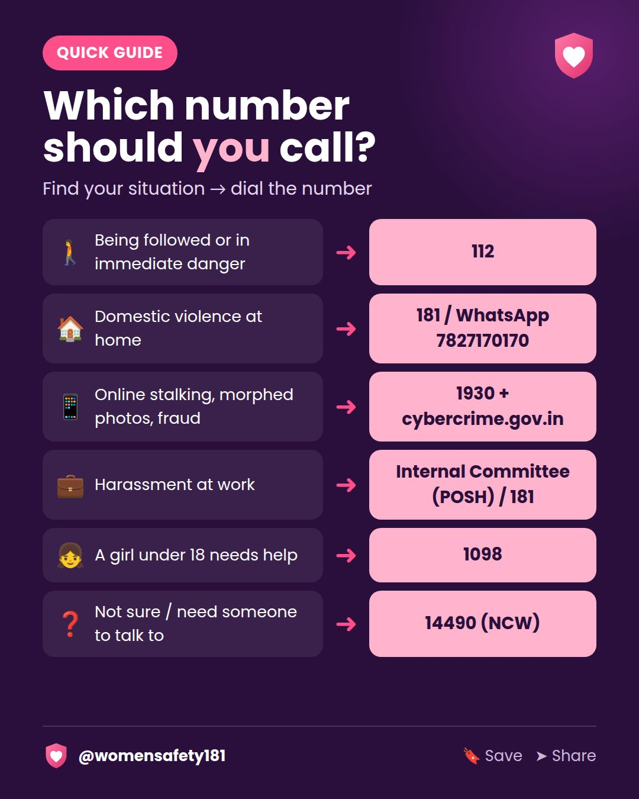
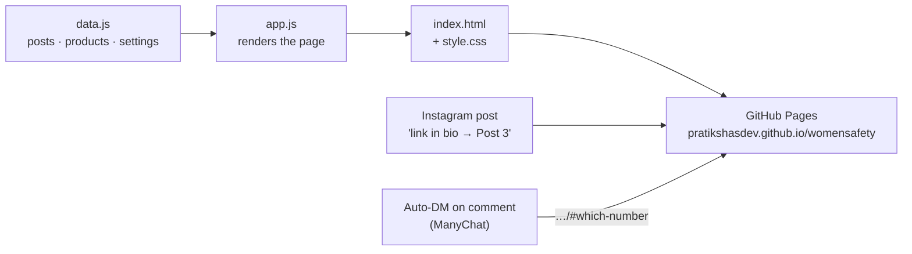

  

<h1 align="center">womensafety181</h1>

  <b>Helplines, safety tools and practical know-how for women in India — one tap from Instagram.</b>

  
  
  
  

---

## About the project

**womensafety181** is an independent awareness project for women's safety in India. It has two parts that work together:

- **The Instagram page [@womensafety181](https://instagram.com/womensafety181)** publishes short, saveable posts: which helpline to call, what happens when you call, and which safety tools are worth carrying.
- **This website** is the page's link in bio. Every Instagram post has its own section here with the links, resources and products it mentions, so a follower who reads "link in bio → tap Post 3" lands on exactly what they need.

Most helpline information online is scattered across government PDFs and state websites. This project puts the essentials in one place, in plain language, designed for a phone screen and for the moment someone actually needs it.

> **Not an official service.** This is an independent awareness page and is not affiliated with the 181 Women Helpline, the National Commission for Women or any government body. **In an emergency, call 112.**

  
  
  

---

## What the website does

| Feature | What it means for a visitor |
|---|---|
| **Emergency numbers first** | 112, 181, 14490 and 1930 sit at the top of the page as tap-to-call buttons, before anything else. |
| **One section per Instagram post** | Each post opens its own panel of links and products, numbered to match Instagram. |
| **Direct links to any post** | `…/womensafety/#3` or `…/#which-number` opens that post straight away, so captions, stories and auto-DMs can point to the exact spot. |
| **Search** | Type a post number, a product ("pepper spray") or a helpline ("181") to find the right post. |
| **Safety tools shop** | Affordable picks with Amazon and Blinkit buttons, approximate prices, and a one-line reason to carry each. |
| **Copy-link button** | Every post has a button that copies its direct link, ready to paste into a DM. |
| **Phone-first design** | Built for a 400 px screen, readable in one hand, with large tap targets. |
| **Lightweight and private** | No accounts, no cookies, no tracking scripts. The whole site is a few small files. |

## Content so far

| # | Instagram post | On the website |
|---|---|---|
| 1 | Numbers every woman in India must save | Helplines + NCW link |
| 2 | Safety tools every woman should carry | Pepper spray, alarm, whistle, torch, power bank |
| 3 | Which number should you call? | Cyber crime portal + NCW helpline directory |

---

## How it's built

The site is plain HTML, CSS and JavaScript with **no framework and no build step**. All content lives in one data file, and the page renders itself from it in the browser.

| File | Role |
|---|---|
| [`data.js`](data.js) | The content: every post, every product, the Amazon tag. Adding a post is one small block of text. |
| [`app.js`](app.js) | Builds post panels and product cards, handles search, deep links (`#3`, `#post-3`, `#which-number`) and copy-link. |
| [`index.html`](index.html) · [`style.css`](style.css) | Page shell and brand styling (plum and pink, Poppins). |
| [`images/`](images) | Post artwork and logo. |

**Design decisions**

- **Data separate from code.** Products are defined once and reused across posts, so a new post usually means adding only its id, title, image and a list of product names.
- **Deep links over separate pages.** One page with anchors keeps hosting free and simple, and every link still lands on the right post.
- **Links that don't break.** Amazon buttons use tagged search links by default, so they keep working when a specific listing goes out of stock. Exact product links are supported too.
- **Accessible by default.** Native `
` panels, visible keyboard focus, alt text on images and reduced-motion support.

---

## Roadmap

Ideas planned for the website and the Instagram page. ✅ = done.

### Website

- ✅ Emergency numbers, per-post sections, deep links, search, safety tools shop
- ⬜ **State helpline finder**: choose your state to see its police, women's commission and One Stop Centre contacts
- ⬜ **Hindi and Marathi versions** of the page
- ⬜ **"Share my location" button** that opens an SMS with your live location for a trusted contact
- ⬜ **Save to home screen (offline)** so helpline numbers still open without internet
- ⬜ **Downloadable lock-screen wallpaper** with emergency numbers
- ⬜ **Interactive checklists**: night travel, cab rides, hotel and PG safety
- ⬜ **Privacy-friendly visit counts** to learn which posts help people most

### Instagram

- ✅ Helpline series: what to save and which number to call
- ⬜ **What happens when you call 181**, step by step
- ⬜ **Know your rights** series: Zero FIR, POSH Act, rights during arrest, cyber complaints
- ⬜ **Myth vs fact** carousels
- ⬜ **Reels**: 30-second demos of the phone SOS shortcut and safety apps
- ⬜ **Story Highlights**: Helplines · Tools · Rights · Travel
- ⬜ **State-by-state series** linked to the state helpline finder

---

## Disclosures

- **Affiliate links:** As an Amazon Associate, this project earns from qualifying purchases. It costs buyers nothing extra. Prices shown are approximate.
- **Accuracy:** Helpline numbers are checked against official sources such as [ncw.gov.in](https://www.ncw.gov.in/other-useful-helplines/) and [cybercrime.gov.in](https://cybercrime.gov.in/), but services can change. Report a wrong number by opening an issue.
- **Pepper spray** is legal to carry in India for self-defence but is not allowed on flights.

## Feedback

Spotted an outdated number, a broken link, or have an idea for a post? [Open an issue](../../issues) or message [@womensafety181](https://instagram.com/womensafety181) on Instagram.

---

  Built and maintained by <a href="https://github.com/pratikshasdev">@pratikshasdev</a> · Content © womensafety181

